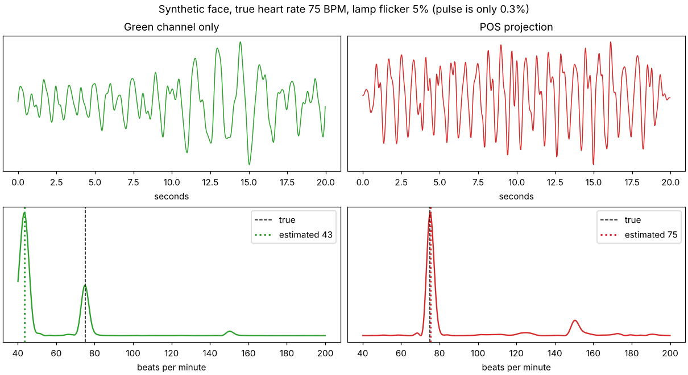

# heartbeam

Measures heart rate from a normal webcam, without touching the person.

> This is an academic project. I made it only to learn about signal processing and
> computer vision, it has no other goal and it's not meant to be used for anything real
> (definitely not medical stuff).

## The idea

Every time the heart beats, a bit more blood goes into the small vessels of the face, and
blood absorbs green light. So the colour of the skin changes a tiny bit (around 0.1-0.5%)
at every beat. You can't see it, but a camera can if you average a lot of skin pixels.
This is called remote photoplethysmography (rPPG).

What the program does, frame by frame:

1. finds the face (OpenCV Haar cascade) and takes forehead and cheeks, skipping eyes and
   mouth because they move
2. takes the mean RGB colour of those pixels
3. resamples everything at a fixed 30 Hz, because webcams don't give frames at a steady rate
4. applies the POS algorithm ([Wang et al. 2017](https://doi.org/10.1109/TBME.2016.2609282)),
   which cancels out changes of brightness
5. band-pass filter between 42 and 240 bpm and takes the highest peak of the spectrum

It also computes an SNR for each reading, so it can say when the signal is bad instead of
showing a random number.

I first tried using only the green channel, like in the older papers, but it breaks as soon
as the light changes. This plot is made with synthetic data (true value 75 bpm, the light
flickers by 5% while the pulse is 0.3%):



The green channel locks onto the light at 43 bpm, POS finds 75. The plot is generated by
`scripts/make_figure.py`.

## Running it

```bash
git clone https://github.com/asgarraaaaa/heartbeam
cd heartbeam
pip install -e ".[dev]"

heartbeam                               # webcam, press q to quit
heartbeam --video clip.mp4 --headless   # just prints the result
heartbeam --video clip.mp4 --csv out.csv
heartbeam --roi 200,120,160,160         # fixed region instead of face detection
```

It works best with good light from the front and staying still for ~10 seconds.

## Tests

```bash
pytest
```

The tests use synthetic signals and videos where I know the real heart rate
(`heartbeam/synth.py`), so I can check the error (within 1.5 bpm between 48 and 170 bpm),
that it doesn't get fooled by light flicker, and that pure noise gets low confidence.

## Limitations

- moving, talking or bad light make it a lot worse
- compressed video can remove the colour changes completely
- the Haar face detector is old and not very stable
- it works worse on very dark (and very light) skin, which is a known problem with rPPG

## References

- Wang, den Brinker, Stuijk, de Haan, *Algorithmic Principles of Remote PPG*, IEEE TBME 2017
- de Haan, Jeanne, *Robust Pulse Rate From Chrominance-Based rPPG*, IEEE TBME 2013
- Verkruysse, Svaasand, Nelson, *Remote plethysmographic imaging using ambient light*, Optics Express 2008
